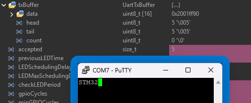
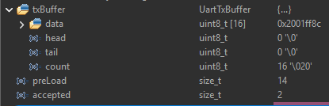
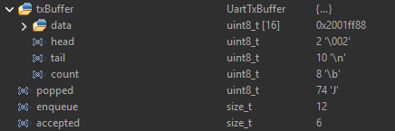
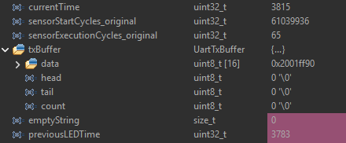
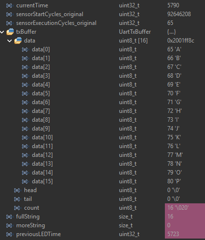
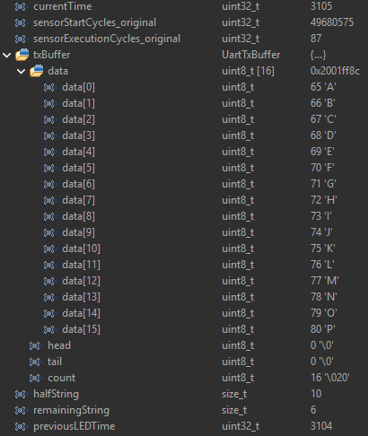

# Experiment 12D - String transmission and partial enqueueing

Full strings, partial strings, FIFO wraparound, and correct UART output

## 1. Objective

Our goal is to create and use a nonblocking function to push a string into our FIFO circular buffer. We will test and analyze different cases of pushing a string into the buffer, transmitting the data through UART, and how it behaves under different circumstances. We will observe the number of characters enqueued, preservation of insertion order, FIFO capacity and overflow handling, and proper transmitting of characters under different conditions when the buffer is empty, full, or partially empty.

## 2. Hypothesis

We hypothesize that UART_TX_PushString() will read a null-terminated string one character at a time and use the existing UART_TX_Push() function to enqueue each character into the circular FIFO buffer.

The function is expected to stop when it encounters the null terminator ('\0') or when an insertion fails because the buffer is full. It will return the number of characters successfully enqueued. If either input pointer is NULL, the function is expected to return zero without modifying the buffer.

For an initially empty FIFO, we expect the function to accept up to 16 characters. For a partially filled FIFO, we expect it to accept as many characters as possible, limited by the string length and the remaining buffer capacity, without overwriting existing data.

For an empty string, we expect the function to return zero without modifying the FIFO's contents or state.

## 3. Experimental Setup

We will continue using our STM32F446RE, UART peripheral USART2. 115200 baud rate, 8 data bits, no parity, 1 stop bit (8N1), and no flow control on PuTTY. The firmware was compiled with optimization disabled (-O0).  FIFO circular buffer capacity is 16 bytes. We are using bare metal C programming and direct register access to write the firmware.

## 4. Methodology

For each test, the circular FIFO buffer is initialized to zero using UartTxBuffer txBuffer = {0}. The test then performs a predefined sequence of string enqueue or dequeue operations. We inspect the return values of the functions and the FIFO's head, tail, count, and data array using the debugger. For Test 1, we additionally enable UART_TX_Service() and verify the transmitted characters using PuTTY.

Test 1 - Basic String Transmission: Push a string using UART_TX_PushString "STM32" into the buffer and service it to PuTTY using the UART_TX_Service()
```C
#if EXPERIMENT_12D_TEST1

//Experiment 12D — Test 1: string enqueue

UartTxBuffer txBuffer = {0};

size_t accepted = UART_TX_PushString(&txBuffer, "STM32");

#endif
```
```C
//Transmit data

	UART_TX_Service(&txBuffer);
```

Test 2 - Partial Insertion: We will fill the buffer partially with 14 bytes and then try to push 5 more bytes to see if the buffer rejects the remaining once it is full.
```C
#if EXPERIMENT_12D_TEST2

//Experiment 12D — Test 2: Partial string enqueue

UartTxBuffer txBuffer = {0};

size_t preLoad = UART_TX_PushString(&txBuffer, "ABCDEFGHIJKLMN");

size_t accepted = UART_TX_PushString(&txBuffer, "HELLO");

#endif
```

Test 3 - FIFO Wraparound: We will insert 12 bytes into the buffer and then pop 10 bytes. After that, we will insert 6 more bytes to test How the FIFO's head, tail, and count values change during the wraparound operation, as observed through the debugger.

```C
#if EXPERIMENT_12D_TEST3

UartTxBuffer txBuffer = {0};

uint8_t popped = 0u;

size_t enqueue = UART_TX_PushString(&txBuffer, "ABCDEFGHIJKL");

	for (uint8_t i = 0; i < 10; i++){

		UART_TX_Pop(&txBuffer, &popped);
	}

size_t accepted = UART_TX_PushString(&txBuffer, "MNOPQR");

#endif
```

Test 4 – Empty String: We will test the case of pushing an empty string to the buffer.

```C
#if EXPERIMENT_12D_TEST4

    UartTxBuffer txBuffer = {0};

	size_t emptyString = UART_TX_PushString(&txBuffer, "");

#endif
```

Test 5 - Full FIFO: In this test, we will fill the buffer with a string of exactly 16 bytes long and try to push more string into it to see if the head, tail, count changes, or does it reject outright.

```C
#if EXPERIMENT_12D_TEST5

	UartTxBuffer txBuffer = {0};

	size_t fullString = UART_TX_PushString(&txBuffer, "ABCDEFGHIJKLMNOP");

	size_t moreString = UART_TX_PushString(&txBuffer, "STM32");

#endif
```

Test 6 – Exact Capacity: The buffer will have a string of 10 characters initially and then will try to push 6 more characters.

```C
#if EXPERIMENT_12D_TEST6

	UartTxBuffer txBuffer = {0};

	size_t halfString = UART_TX_PushString(&txBuffer, "ABCDEFGHIJ");

	size_t remainingString = UART_TX_PushString(&txBuffer, "KLMNOP");

#endif
```

## 5. Experimental Results

| Test | Expected Behavior | Observed Behavior | Result| Evidence |
|----|----|----|----|----|
| Test 1 - Basic String Transmission | After enqueue: head=5, tail=0, count=5, accepted=5. After servicing: count=0. | After enqueue: head=5, tail=0, count=5. After servicing: head=5, tail=5, count=0. PuTTY displayed STM32. | Pass |
| Test 2 - Partial Insertion | preLoad=14, accepted=2, head=0, tail=0, count=16 | All values matched expectations. | Pass |
| Test 3 - FIFO Wraparound | enqueue=12, accepted=6, head=2, tail=10, count=8 | All values matched expectations. | Pass |
| Test 4 - Empty String | emptyString=0, head=0, tail=0, count=0 | All values matched expectations. | Pass |
| Test 5 - Full FIFO | fullString=16, moreString=0, head=0, tail=0, count=16 | All values matched expectations. Original FIFO contents are preserved. | Pass |
| Test 6 - Exact Capacity | halfString=10, remainingString=6, head=0, tail=0, count=16 | All values matched expectations. | Pass |


## 6. Experimental Evidence









## 7. Technical Analysis

### 7.1 String Enqueueing and FIFO Operation

Experiment 12D extends the existing UART circular FIFO implementation by introducing UART_TX_PushString(), a function that accepts a null-terminated C string and attempts to enqueue its characters individually.

The function uses the existing UART_TX_Push() interface rather than directly accessing the USART peripheral. This maintains a separation between data production and UART transmission.

The function processes the input string sequentially and stops when it encounters the null terminator ('\0') or when an insertion fails. It returns the number of characters successfully enqueued, allowing the caller to determine whether the entire string was accepted.

Test 1 verified the normal operation of this mechanism. All five characters of "STM32" were accepted into the FIFO and subsequently transmitted through USART2. After servicing, the buffer was empty, with head = 5, tail = 5, and count = 0.

### 7.2 FIFO Capacity and Partial String Insertion

The circular FIFO has a fixed capacity of 16 bytes. The available capacity depends on the number of characters already stored.

Test 2 demonstrated partial string insertion. After inserting 14 characters, only two positions remained available. An attempt to enqueue "HELLO" resulted in two successfully inserted characters, with the function returning accepted = 2.

The buffer reached its maximum capacity of 16 bytes without exceeding its allocated storage. The remaining three characters were not enqueued.

Test 5 examined insertion into an already-full FIFO. The first call successfully inserted 16 characters, while the subsequent attempt to insert "STM32" returned zero. The debugger confirmed that head, tail, and count remained unchanged and that the original stored characters were preserved.

Test 6 demonstrated that the function can use exactly the available capacity. After initially inserting ten characters, a second insertion of six characters filled the buffer completely.

Together, these tests support the conclusion that the implementation respects the defined FIFO capacity under the tested conditions.

### 7.3 Circular Buffer Wraparound

Test 3 investigated the behavior of the FIFO when its insertion index reached the end of the underlying array.

The test initially inserted 12 characters and then removed ten characters using UART_TX_Pop(). This left two characters in the FIFO, with head = 12, tail = 10, and count = 2.

A subsequent insertion of six characters caused the head index to wrap around the 16-element array boundary.

The final debugger state was:

head = 2

tail = 10

count = 8

accepted = 6

These results confirm that the buffer's index management behaved as expected during the tested wraparound operation.

### 7.4 Empty String Handling

Test 4 verified the behavior of UART_TX_PushString() when an empty string was supplied.

Because the first character of an empty C string is the null terminator, the function's loop condition evaluates to false immediately.

The function returned zero, and the FIFO state remained unchanged, with head = 0, tail = 0, and count = 0.

This demonstrates that the implementation handles an empty string without attempting to enqueue data.

### 7.5 Separation of Enqueueing and UART Transmission

The UART_TX_PushString() function does not directly transmit characters through USART2. Instead, it inserts data into the FIFO, while the existing UART_TX_Service() function is responsible for removing and transmitting queued bytes.

This separation allows data to be prepared for transmission without waiting for each character to be physically transmitted.

However, the enqueue operation still requires processor execution time proportional to the number of characters processed. Therefore, although it avoids waiting for UART transmission hardware, it is not an instantaneous operation.

The experiment demonstrated correct operation of this separation in the tested single-threaded firmware configuration.


## 8. Limitations and Future Improvements

Although all six planned tests passed, the experiment has several limitations.

### 8.1 Partial Message Transmission

The implementation permits partial string insertion when the remaining FIFO capacity is insufficient.

For example, when two slots are available, inserting "HELLO" results in only "HE" being accepted.

Although the function reports the number of accepted characters, it does not automatically preserve the remaining portion of the message for later transmission.

This behavior may be acceptable for some applications but could create incomplete messages in systems that require complete commands or data packets.

A future improvement could investigate all-or-nothing message insertion or a mechanism for retrying characters that were not accepted.

### 8.2 Limited Input Validation Testing

The implementation checks whether the FIFO pointer or string pointer is NULL and returns zero if either is invalid.

However, the six completed tests did not explicitly verify these NULL pointer conditions.

Additional tests would strengthen the validation of this behavior.

### 8.3 No Concurrent FIFO Access Testing

The experiment was conducted using the existing cooperative firmware architecture.

It did not investigate scenarios where an interrupt service routine and the main program access the same FIFO simultaneously.

Consequently, these tests do not establish that the implementation is safe for concurrent access without additional synchronization or architectural constraints.

### 8.4 No Timing or Performance Measurements

The experiment focused on functional correctness rather than execution-time performance.

It did not measure:

Execution time of UART_TX_PushString().

UART transmission latency.

Processor utilization.

Performance under sustained communication workloads.

These measurements would be useful for evaluating the implementation in time-constrained embedded applications.

### 8.5 Fixed Buffer Capacity

The FIFO uses a fixed capacity of 16 bytes, which simplifies testing and memory management.

However, the experiment did not investigate how different buffer capacities affect throughput, buffering requirements, or overflow frequency.

Future experiments could compare multiple buffer sizes under controlled workloads.

## 9. Conclusion

Experiment 12D successfully extended the existing UART circular FIFO implementation to support null-terminated C strings.

The UART_TX_PushString() function was verified through six tests covering basic string enqueueing and transmission, partial insertion, FIFO wraparound, empty strings, full-buffer rejection, and exact-capacity insertion.

All six tests produced the expected results under their respective test conditions.

The experiments demonstrated that the function correctly reports the number of accepted characters, respects the FIFO's capacity, and supports circular-buffer index wraparound. Basic UART transmission was also confirmed through PuTTY.

The implementation provides a foundation for future embedded communication experiments involving message handling, interrupt-driven transmission, and communication performance analysis.

While the completed tests support the functional correctness of the implementation under the tested conditions, further verification would be required before using it in applications involving concurrent access, strict timing requirements, or complete-message delivery guarantees.